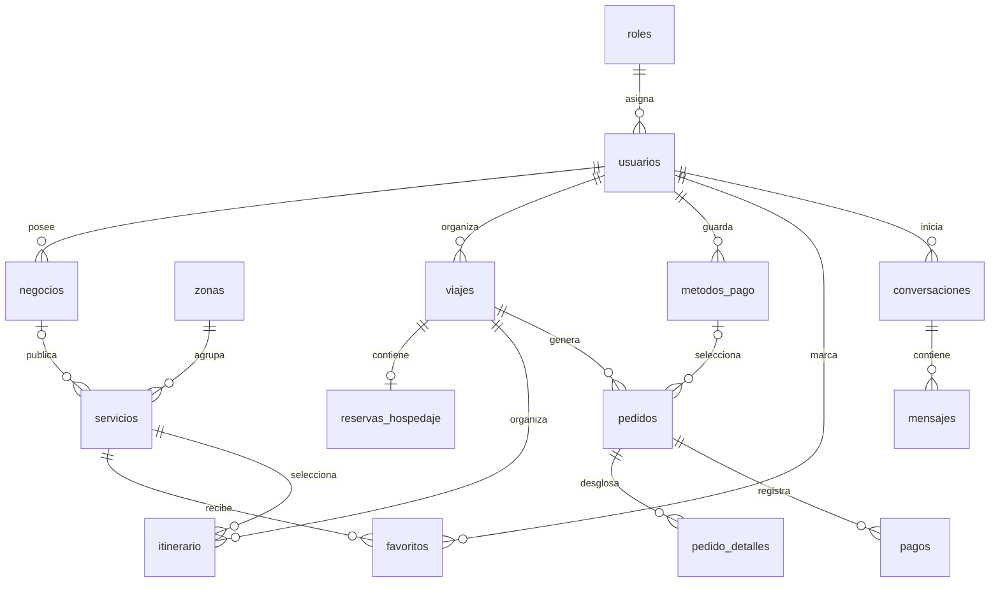

# Base de datos de RELAX

La base `relax` ya está creada en MariaDB de XAMPP (puerto 3307) y conectada mediante la API PHP de `api/`. Los catálogos originales están importados y el registro público crea clientes reales. Se conservaron las 23 tablas del diseño y se agregaron `intentos_acceso` (límite de intentos fallidos) y `catalogo_importacion` (marca de importación inicial).

Motor de destino: MariaDB 10.4.32, encontrado en la instalación local de XAMPP. El archivo `schema.sql` usa InnoDB, utf8mb4, claves foráneas, índices y restricciones CHECK. No borra tablas ni contiene usuarios reales. Se importa una sola vez dentro de una base vacía seleccionada en phpMyAdmin, por ejemplo `relax`. El script no constituye una migración de una base existente ni es idempotente.

## Tablas y campos principales

Todas las columnas y sus tipos, claves, índices y restricciones se encuentran en [schema.sql](schema.sql). `id` es la PK salvo indicación distinta; los campos terminados en `_id` indicados abajo son FK.

| Tabla | Campos principales | Propósito |
| --- | --- | --- |
| roles | id, nombre | Administrador, cliente y empresario |
| usuarios | id, rol_id, nombre, correo único, contrasena_hash, telefono, estado, correo_verificado_en | Registro, credenciales y perfil |
| sesiones | id, usuario_id, token_hash único, expira_en, revocada_en | Sesiones del futuro backend; almacenar hash del token |
| zonas | id, slug único, nombre, resumen, emoji, activo | Huasca de Ocampo, Real del Monte, Mineral del Chico |
| negocios | id, propietario_id, nombre, descripcion, telefono, correo_contacto, estado | Negocios de empresarios y aprobación administrativa |
| servicios | id, zona_id, negocio_id opcional, tipo, slug, nombre, categoria, descripcion, direccion, precio_base, moneda, calificacion_catalogo | Catálogo común de hospedajes, actividades, restaurantes y lugares |
| imagenes_servicio | id, servicio_id, url, texto_alternativo, orden | Galerías; no se guardan imágenes binarias en la tabla |
| hospedajes | servicio_id (PK/FK), habitacion, capacidad, camas, banos, hora_entrada, hora_salida | Datos específicos de cada opción de alojamiento |
| amenidades | id, nombre único | Wi-Fi, estacionamiento y demás comodidades |
| hospedaje_amenidades | hospedaje_id + amenidad_id (PK compuesta) | Relación de muchas comodidades por hospedaje |
| politicas_hospedaje | id, hospedaje_id, descripcion, orden | Políticas mostradas en el detalle |
| actividades | servicio_id (PK/FK), duracion_minutos | Duración; precio y categoría se leen de servicios |
| restaurantes | servicio_id (PK/FK), tipo_comida, menu_descripcion | Tipo de cocina y menú; precio_base es consumo promedio |
| viajes | id, usuario_id, zona_id, nombre, fecha_inicio, fecha_fin, estado | Historial de viajes por cliente, aunque la UI hoy muestra uno |
| favoritos | usuario_id + servicio_id (PK compuesta), creado_en | Sin duplicados; inicialmente actividades y restaurantes |
| metodos_pago | id, usuario_id, tipo, titular, ultimos4, proveedor, token_proveedor, activo | Crédito, débito, efectivo, transferencia y OXXO |
| pedidos | id, usuario_id, viaje_id, metodo_pago_id, snapshots del método, estado, total, moneda | Compra/confirmación asociada al viaje |
| pedido_detalles | id, pedido_id, servicio_id, nombre_snapshot, unidad, cantidad, precio_unitario | Desglose histórico de noches o personas |
| reservas_hospedaje | id, viaje_id único, hospedaje_id, pedido_detalle_id, llegada, salida, huespedes, precio_noche, estado | Un alojamiento por viaje, igual que el contexto actual |
| itinerario | id, viaje_id, servicio_id, pedido_detalle_id opcional, fecha, personas, precio_persona, orden | Actividades, restaurantes y lugares del viaje |
| pagos | id, pedido_id, tipo, proveedor, referencia_externa, clave_idempotencia, importe, moneda, estado | Intentos de pago y confirmaciones; puede haber varios por pedido |
| conversaciones | id, usuario_id, viaje_id opcional | Historial opcional del asistente |
| mensajes | id, conversacion_id, autor, pregunta_clave, contenido, creado_en | Preguntas y respuestas; no requiere un modelo de IA |

Los lugares se guardan directamente como servicios de tipo `lugar`; no necesitan una tabla adicional. Las calificaciones actuales son datos del catálogo, no reseñas de usuarios. No se añade un módulo de reseñas porque todavía no existe en la aplicación.

## Relaciones principales

## Registro y acceso

El registro público de la página principal acepta nombre, correo, contraseña y teléfono opcional, y crea exclusivamente clientes. Solo un administrador autenticado puede dar de alta una cuenta de empresa y su negocio mediante la API. No se puede elegir empresario ni administrador en el formulario público; el backend rechaza intentos de enviar esos roles. El primer administrador se generó con contraseña aleatoria, guardada en un archivo privado local.

El inicio de sesión recibe solamente correo y contraseña. El servidor verifica el hash, consulta `usuarios.rol_id` y devuelve una sesión y el rol; la app decide qué pantalla abrir. Las autorizaciones se verifican también en cada endpoint: abrir una pantalla o enviar un rol desde el cliente no otorga permisos. Empresario solo administra servicios de sus propios negocios; cliente solo consulta y cambia sus viajes, favoritos y métodos. Administrador gestiona usuarios, catálogos y aprobaciones.

Nunca guardar contraseñas en texto plano ni recuperables. Generar/verificar el hash en el backend con una biblioteca de contraseñas mantenida. Normalizar el correo antes de insertarlo y usar consultas parametrizadas. `sesiones.token_hash` representa el hash de un token aleatorio del servidor, no una contraseña.

## Pedidos, itinerario y pagos

1. Guardar viaje, hospedaje, huéspedes y fechas. Las fechas se guardan como DATE, no como cadenas `dd/mm/aaaa`.
2. Añadir actividades/restaurantes/lugares en itinerario. La restricción `(viaje_id, servicio_id)` reproduce la actualización de selecciones por elemento actual; para permitir el mismo servicio en varios días habría que cambiarla.
3. Al confirmar un pedido, recalcular sus precios en el servidor y guardar detalles, reserva e importes en una transacción. Una noche usa el precio del hospedaje; una actividad usa precio por persona. Los consumos de restaurantes y lugares permanecen fuera del total actual.
4. Conservar `nombre_snapshot`, precios y método seleccionado del pedido aunque el catálogo cambie. Las FK compuestas impiden asociar al pedido un viaje o método perteneciente a otro usuario.
5. Guardar cada intento en pagos. Elegir un método o confirmar la reserva no equivale a recibir dinero. Efectivo, OXXO y transferencia permanecen pendientes hasta confirmar el cobro. El proveedor/backend, no la app, determina que un pago fue aprobado.
6. La clave de idempotencia identifica una operación lógica; reintentos de la misma operación deben reutilizarla. Una nueva operación usa una nueva clave. La referencia externa evita registrar dos veces la misma confirmación del proveedor.

Solo se guardan metadatos de tarjetas: titular, terminación y token del proveedor cuando exista. No almacenar número completo, CVV ni credenciales bancarias. Un método desactivado se marca `activo=false` para conservar el historial de pedidos. El método se puede guardar desde Perfil o durante el pago y pertenece siempre al usuario autenticado.

## Reglas del backend

Las FK y CHECK cubren existencia, propiedad de viaje/método en pedidos, importes no negativos, fechas ordenadas y duplicados. La API ya valida roles, propiedad, zona, fechas, capacidad y precios con pruebas de integración. Las siguientes reglas explican las responsabilidades que deben conservarse al extenderla:

- El propietario de negocio debe ser empresario; solo un administrador puede aprobarlo.
- El tipo de `servicios` debe coincidir con su tabla específica: hospedaje, actividad o restaurante. Cada alta debe guardar ambas filas en una transacción.
- Itinerario solo admite actividades, restaurantes o lugares; sus fechas deben caer dentro de la estancia y su zona debe coincidir con el viaje.
- Reserva y viaje deben coincidir en fechas y zona. Los huéspedes no deben exceder la capacidad.
- Un `pedido_detalle_id` ligado a una reserva/itinerario debe pertenecer al mismo viaje y servicio. Solo se cobran hospedajes y actividades por ahora.
- El total debe igualar la suma de cantidad por precio unitario de sus detalles, en una misma moneda. Los pagos aprobados no deben superar lo debido y las transiciones de estado deben ser válidas.
- Al cambiar hospedaje, fechas o zona se deben revisar las selecciones existentes. Cancelar una reserva no debe eliminar pagos ni pedidos históricos.
- Normalizar los tipos de duración, precios y fechas al migrar los archivos TypeScript. No usar los nombres como identificadores; usar claves estables.

Este modelo representa el catálogo y la reserva local actuales; NO resuelve inventario real ni evita por sí solo sobreventas. Antes de vender disponibilidad real habrá que definir unidades/habitaciones, cupos y bloqueos por fecha con transacciones. Tampoco incluye facturación fiscal ni reembolsos parciales, módulos que aún no existen.

## Conexión implementada

Expo → API PHP → MariaDB. La app no contiene credenciales de la base. Se conectaron registro/login, perfil, catálogos, viajes, favoritos, métodos, pedidos y mensajes. El asistente conserva sus reglas locales y persiste el historial por usuario. Consulta [api/README.md](../api/README.md) para endpoints, acceso inicial privado, instalación y pruebas. No se conectó una pasarela ni se crearon pantallas administrativas nuevas.

Referencias de sintaxis: [CREATE TABLE de MariaDB](https://mariadb.com/docs/server/server-usage/tables/create-table) y [claves foráneas de MariaDB](https://mariadb.com/docs/server/ha-and-performance/optimization-and-tuning/optimization-and-indexes/foreign-keys).
